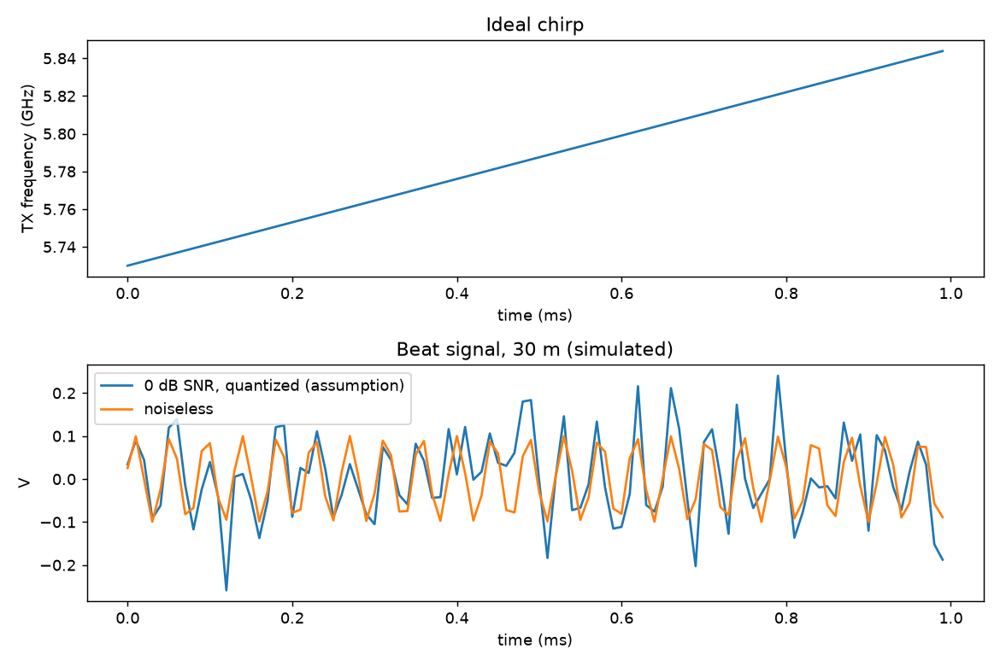
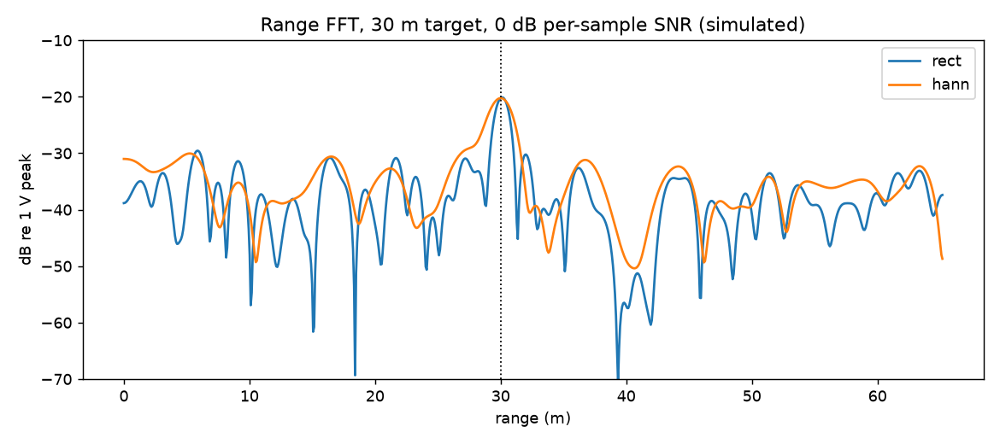
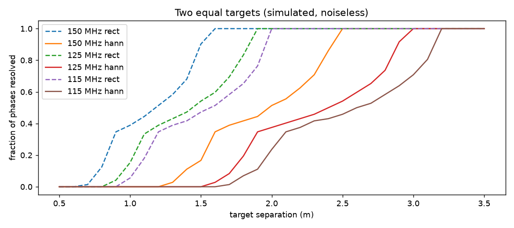
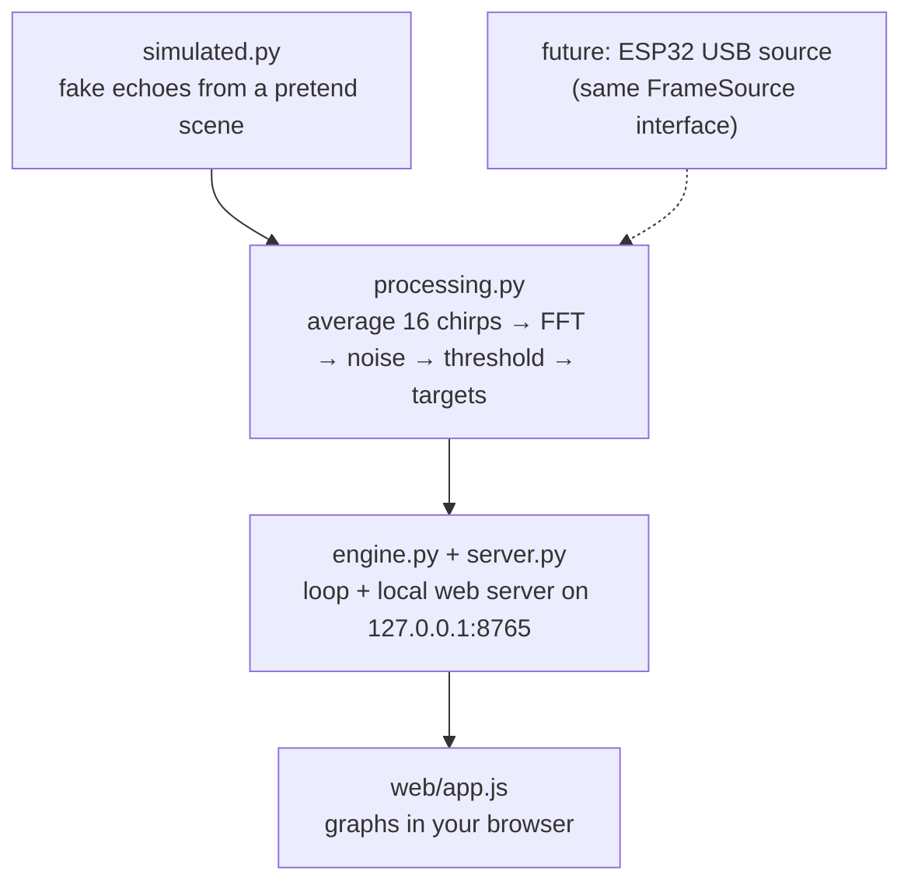
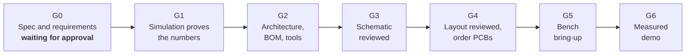

# Learn: SPECULA-1 explained simply

This project is a learning project. We are building a small, low-cost radar to learn how radar works, and we document it so that anyone can learn with us. You do not need a background in radio or signal processing to read this page.

- **Interactive version:** [open it online](https://emilio-guadarrama.github.io/fmcw-radar-5g8/). It has sliders you can move to see how the radar reacts. The source is [radar-guide.html](radar-guide.html), and it also works offline if you open it in a browser.
- **This page** covers the same topics and displays directly on GitHub.

> The numbers here are design targets (assumptions) or values calculated in simulation. **No hardware has been built or measured yet.** The source of truth is [requirements.md](../requirements.md) and the [decisions](../decisions/).

## Contents

1. [The core idea](#1-the-core-idea-a-sliding-whistle)
2. [The hardware chain](#2-the-hardware-chain)
3. [The FFT](#3-the-fft-a-prism-for-signals)
4. [Resolution](#4-resolution-when-do-two-objects-look-like-two)
5. [Why 115 MHz](#5-why-115-mhz-the-legal-question)
6. [Goals](#6-what-success-means)
7. [The repository](#7-whats-in-the-repository)
8. [The gates](#8-the-gates)
9. [Try it yourself](#9-try-it-yourself)
10. [Glossary](#10-glossary)

## 1. The core idea: a sliding whistle

**FMCW** means *Frequency-Modulated Continuous Wave*. The radar transmits **all the time** (continuous wave) while its frequency rises in a straight line (frequency-modulated). One rise is called a **chirp**. Here a chirp lasts 1 ms.

> **Analogy: singing in a canyon.** Sing a note that slides smoothly upward. Your voice bounces off a cliff and comes back a moment later. By then you are singing a higher note than the echo. The further the cliff, the bigger the difference. That difference is the **beat frequency**, and it is what the radar measures.

```
frequency
   ^        sent (TX)      echo (RX), arrives a little later
   |          /         /
   |        /  ↕ beat  /
   |      /          /
   |    /          /
   |  /          /
   +-------------------------> time
       one chirp = 1 ms
```

The one formula that matters:

```
beat frequency  f_b = 2 · R · S / c

R = distance to the target (m)
S = slope = how fast the frequency rises = B / T = 115 MHz / 1 ms = 1.15e11 Hz/s
c = speed of light, about 300 000 km/s
2 = the wave travels there AND back
```

At 30 m the beat is about **23 kHz** (calculated). A 5.8 *billion* Hz radio problem becomes a 23 *thousand* Hz problem, slow enough for a cheap chip to record. That is the main trick of FMCW.

Real simulation output from [sim/](../../sim/): the chirp and the beat signal.



## 2. The hardware chain

Planned design, **not built yet**.

```mermaid
flowchart LR
    subgraph make["1 · Make the chirp"]
        PLL["PLL ADF4159<br/><i>the conductor</i>"] --> VCO["VCO HMC431<br/><i>the singer</i>"] --> SPL["Splitter<br/><i>Y-cable</i>"] --> TX["TX antenna<br/><i>the mouth</i>"]
    end
    TX -. "wave out" .-> TGT(["Target 3–30 m"])
    TGT -. "echo back" .-> RX
    subgraph catch["2 · Catch and compare"]
        RX["RX antenna<br/><i>the ear</i>"] --> LNA["LNA HMC717<br/><i>hearing aid</i>"] --> MIX["Mixer HMC219<br/><i>the comparer</i>"] --> AMP["Amp + filter<br/><i>volume + bouncer</i>"]
    end
    SPL -- "copy of the chirp (LO)" --> MIX
    subgraph data["3 · Record and calculate"]
        ADC["ADC<br/><i>recorder</i>"] --> MCU["ESP32-S3<br/><i>courier</i>"] -- USB --> PC["PC · Python FFT<br/><i>translator</i>"]
    end
    AMP -- "~23 kHz beat" --> ADC
```



| Part | What it does | Analogy |
|---|---|---|
| **PLL** (Phase-Locked Loop), ADF4159 | Keeps correcting the VCO so the frequency ramp is a straight line. Uses a steady crystal clock (TCXO) as reference. | A conductor with a metronome |
| **VCO** (Voltage-Controlled Oscillator), HMC431 | Makes the 5.7–5.8 GHz wave. More voltage, higher frequency. | The singer, who drifts without the conductor |
| **Splitter** (Wilkinson divider) | Sends the chirp to the antenna and keeps a copy for the mixer. Printed on the board. | A headphone Y-cable |
| **Antennas** | Turn electrical signals into radio waves and back | Mouth and ear |
| **LNA** (Low-Noise Amplifier), HMC717 | Boosts the faint echo without adding much hiss | A hearing aid |
| **Mixer**, HMC219 | Multiplies the echo by the copy. The output is their difference: the beat | Two tuning forks slightly off-pitch make a slow "wah-wah" |
| **Baseband amp + anti-alias filter** | Makes the beat louder and blocks frequencies too high to record correctly | A volume knob plus a bouncer |
| **ADC** (Analog-to-Digital Converter) | Measures the voltage 100 000 times per second and turns it into numbers | A microphone recording to a file |
| **ESP32-S3** | A small microcontroller that sends the numbers over USB | A courier |
| **Python on a PC** | Finds the beat frequency with an FFT, converts it to distance, draws it live | A translator from "sound" to meters |

Version 1 has **no power amplifier** on purpose: low power, indoors, bench first. Estimated parts cost: about US$134 per board (see the [BOM](../../bom/)).

## 3. The FFT: a prism for signals

If there are three objects, the mixer output contains three tones on top of each other. The **FFT** (Fast Fourier Transform) separates them.

> **Analogy: a prism, or the bars on a music equalizer.** A prism splits white light into colors. The FFT splits the beat signal into tones. Each bar ("bin") is a distance slot, and a tall bar means "something is there".



## 4. Resolution: when do two objects look like two?

The **range bin** is `c / (2B)`. With B = 115 MHz that is **1.30 m** (calculated). But each object makes a *hill* in the spectrum, not a thin line, and two hills close together merge. In simulation, two equal objects need about **2.0 m** between them to show as two peaks, so the project's goal is **2.5 m or less** ([decision 002](../decisions/002-performance-targets.md)).

> **Analogy: car headlights at night.** Far away, two headlights blur into one blob. Closer, you see two lights. Resolution is the point where one blob becomes two.



The **window** is a fade-in and fade-out applied to each chirp before the FFT:

- **Rectangular** (no fade): sharp hills, but small fake bumps (side lobes) that can hide a weak object next to a strong one.
- **Hann** (smooth fade): clean hills, but wider.

> **Analogy: camera lenses.** Rectangular is a sharp lens with lens flare. Hann is a slightly soft lens without flare.

## 5. Why 115 MHz: the legal question

Radio frequencies are like highway lanes: most need permission. Mexico's regulator lists **5725–5850 MHz** as free spectrum. The original plan swept up to 5875 MHz, outside that lane, so the team chose a narrower sweep ([decision 001](../decisions/001-sweep.md)).

```
5725                                    5850        5875 MHz
 |------------- listed free band -------|
 |------------- Option A: 150 MHz, simulation and cables only ---|
   |---------- Option C: 115 MHz, chosen ---------|
  5730                                   5845
```

- A 5 MHz **guard** on each edge keeps the imperfect real signal inside the lane.
- The cost: the range bin grows from 1.0 m to 1.3 m.
- **Nothing is cleared to transmit.** It is still unconfirmed whether an FMCW radar qualifies for that band (open item M-01). Until then, tests use cables and a **dummy load**, a plug that absorbs the signal instead of broadcasting it.

## 6. What success means

Targets from [decision 002](../decisions/002-performance-targets.md). All are **assumptions** until measured.

| Goal | Value | In plain words |
|---|---|---|
| Range | 3–30 m | Objects between 3 and 30 m away, indoors |
| Two-target resolution | 2.5 m or less | Two equal objects 2.5 m apart show as two peaks |
| Accuracy | 0.20 m or less, 95 % of tries | Within 20 cm in 95 of 100 tries, when the echo is clear (SNR 20 dB or more) |
| Detection | Pd 0.90 or more at Pfa 1e-4 | Finds a real object 90 % of the time; false alarm in at most 1 of 10 000 empty slots |
| Update rate | 10 Hz or more | At least 10 new readings per second |
| Latency | 200 ms or less | The screen lags reality by at most a fifth of a second |
| Reference target | 15 cm corner reflector | A three-sided metal corner that bounces radio straight back, like a bike reflector does with light |

> **Analogy: a smoke alarm.** **Pd** (probability of detection) is how often it rings when there is real smoke. **Pfa** (probability of false alarm) is how often it rings when you are only making toast. A lower threshold catches more fires but gives more false alarms.

## 7. What's in the repository

| Folder | Contents | State |
|---|---|---|
| [docs/](../) | Charter, requirements, decisions, gate reviews, and this guide | Active |
| [sim/](../../sim/) | Math model of chirp, echo, noise, ADC and FFT, with tests and plots | Working |
| [software/](../../software/) | Live radar display in the browser, fed by **simulated** data | Preliminary |
| [bom/](../../bom/) | Parts list with prices | Has known inconsistencies |
| [hardware/](../../hardware/) | Circuit board design (Altium) | Empty |
| [firmware/](../../firmware/) | ESP32-S3 program | Empty |
| [tests/](../../tests/) | Bench test procedures and logs | Empty |

How the live display is organized:



`source.py` defines one "plug shape" (`FrameSource`). The simulator fits it today. When the hardware exists, a USB version with the same shape replaces it and the rest stays the same, like swapping chargers without changing the phone.

## 8. The gates

The project moves through seven approval steps. The owner approves each one.



Next big topics for Gate 1:

- **Link budget:** an accounting sheet of how much signal survives the round trip.
- **Leakage:** the TX antenna "shouting" straight into the RX antenna.
- **Clutter:** walls and furniture echoing back.
- **Phase noise:** the singer's voice wobbling.

## 9. Try it yourself

You need Python 3.12 or newer (the pinned NumPy needs 3.12). In PowerShell, from the repository folder:

```powershell
python -m venv .venv
.venv\Scripts\python.exe -m pip install -r sim/requirements.txt
.venv\Scripts\python.exe -m pytest sim software -q
.venv\Scripts\python.exe sim/run_sim.py
.venv\Scripts\python.exe software/run_display.py
```

The last command opens the live display at `http://127.0.0.1:8765/`, using **simulated** data. Press Ctrl+C to stop it. More options are in [sim/README.md](../../sim/README.md) and [software/README.md](../../software/README.md).

## 10. Glossary

| Term | Meaning |
|---|---|
| GHz / MHz / kHz | Billions / millions / thousands of vibrations per second |
| Chirp | One sweep of rising frequency (1 ms here) |
| Sweep bandwidth (B) | How far the chirp climbs: 115 MHz. Wider gives finer distance detail |
| Slope (S) | How fast it climbs: B divided by chirp time |
| Beat frequency | Difference between what is sent now and the echo. Proportional to distance |
| TX / RX | Transmit / receive |
| LO (local oscillator) | The copy of the chirp fed to the mixer |
| Baseband | The slow signal after mixing (kHz), easy to record |
| Sample rate (kSPS) | Thousands of samples per second taken by the ADC |
| Nyquist / aliasing | You can only record tones up to half the sample rate. Faster ones disguise themselves as slower ones, like wagon wheels spinning backwards in films |
| Range bin | One distance slot in the FFT output, c/(2B) wide |
| Window (Hann, rectangular) | Fade applied before the FFT, trading sharpness for cleanliness |
| Side lobes | Small fake bumps beside a real peak |
| SNR / dB | Signal-to-noise ratio. Decibels are a log scale: +10 dB is 10 times more power |
| Noise floor | The background hiss everything must rise above |
| Threshold / CFAR | The "loud enough to count" line. CFAR sets it automatically from the measured noise |
| Waterfall | A scrolling picture of the spectrum over time |
| Doppler | Pitch shift from motion, like a passing ambulance. Velocity is a later goal |
| EIRP | Effective radiated power: transmitter power times antenna focus. Legal limits use it |
| ISM band | Radio lanes set aside for industrial, scientific and medical use, like Wi-Fi's |
| Dummy load | A plug that absorbs the signal so nothing is broadcast |
| VNA | Vector Network Analyzer: tests antennas and cables. Must reach 6 GHz here |
| S11 | How much signal bounces back from an antenna instead of going out. Lower is better |
| BOM | Bill of materials: the parts shopping list |
| PCB / schematic / layout | Circuit board / wiring diagram / where parts and copper traces go |
| Firmware | The program running on the ESP32 chip |
| Link budget | Accounting of signal gains and losses on the round trip |
| Radar cross-section | How "big" an object looks to the radar, in m² |
| CRT (formerly IFT) | Mexico's telecom regulator |
